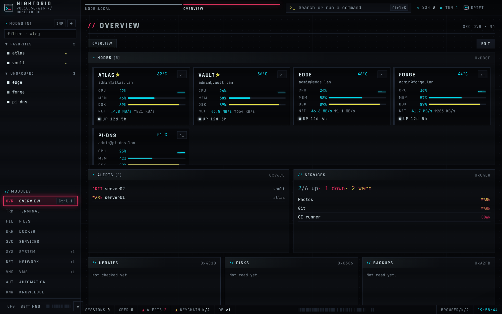
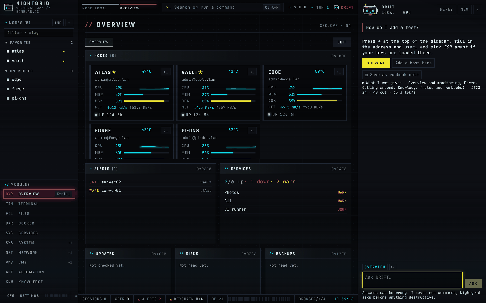
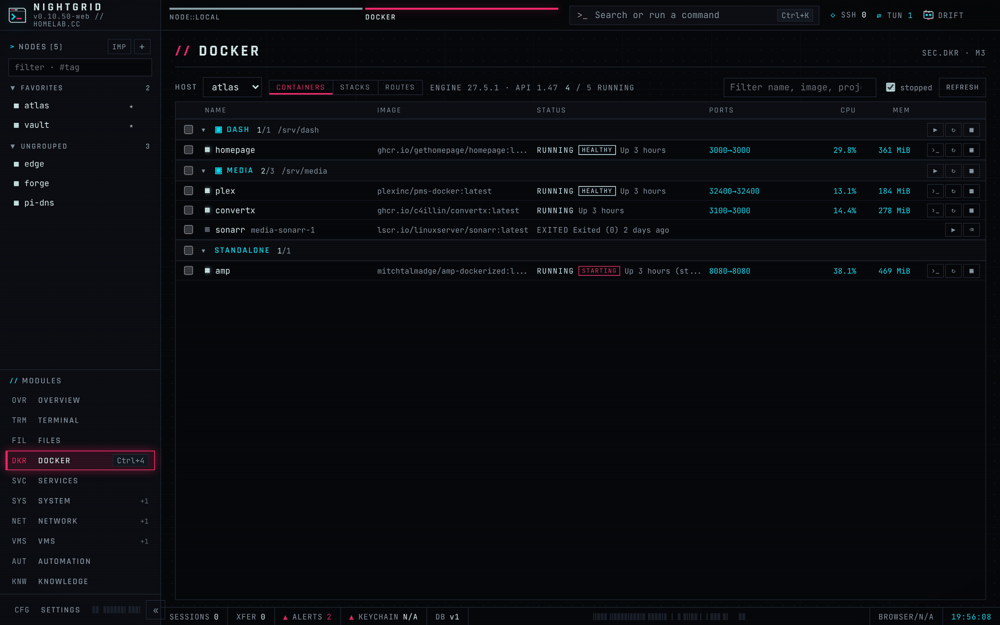
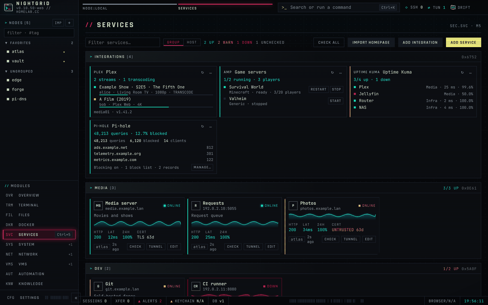
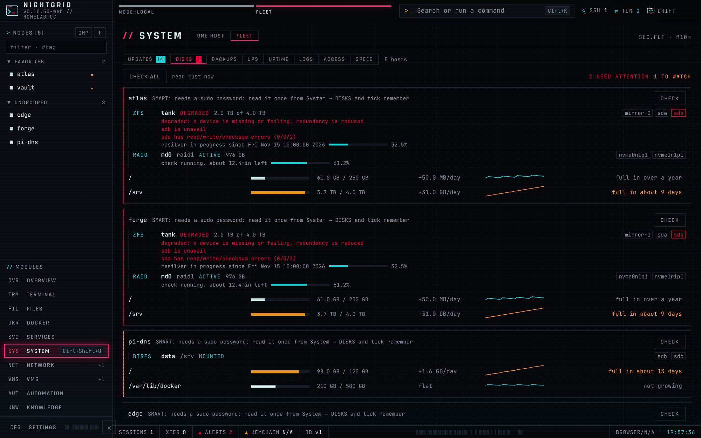
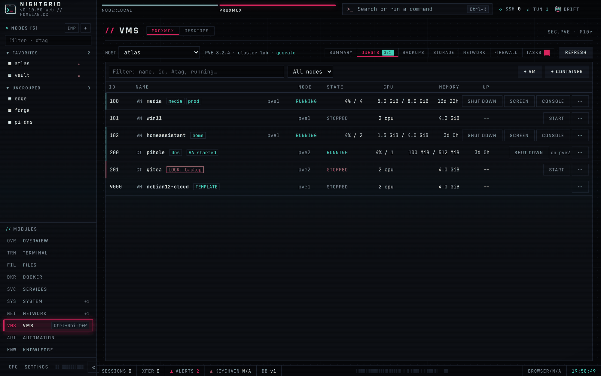
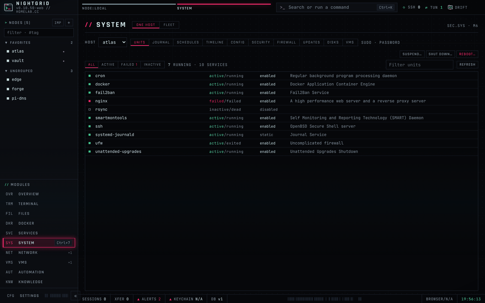
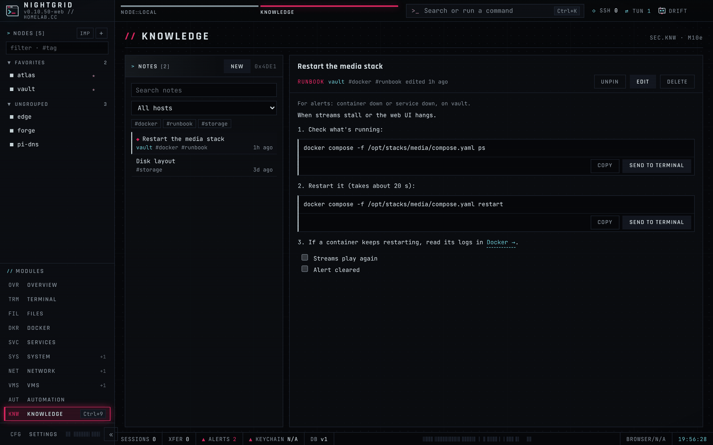

<div align="center">

# NIGHTGRID

**Your whole homelab in one window. No agents, no cloud, just SSH.**

Terminals, files, Docker, monitoring, services, VMs, alerts and a local AI helper in a single fast desktop app for macOS, Windows and Linux.



</div>

## Why Nightgrid

Most homelabs end up as a pile of browser tabs: Portainer for containers, Uptime Kuma for checks, Proxmox for VMs, a dashboard for links, and a terminal app on the side. Nightgrid pulls all of that into one native app that talks to your machines the way you already do, over SSH.

- **Agentless.** Nothing to install on your servers. If you can `ssh` in, Nightgrid can manage it. Host scripts are plain POSIX shell, run over your own connection and gone when they finish.
- **Local-first.** Your hosts, history and settings live in a local SQLite database. Passwords and tokens go to the OS keychain. There is no account, no telemetry and no cloud service in the loop.
- **Fast and light.** Tauri 2 + Rust core with a Svelte 5 UI: a small native binary, not an Electron bundle. Views you turn off are never loaded, and their background jobs never start.
- **Built for keyboards.** Every view has a shortcut, and `Mod+K` (Cmd on macOS, Ctrl elsewhere) jumps to any host, container, snippet or action by typing.
- **Careful by default.** Destructive actions name exactly what they touch, risky commands are flagged before they run, and firewall or network changes arm an automatic rollback on the host before they apply.

## What's inside

| | |
|---|---|
| **Terminal & files** | Tabbed, split SSH terminals with auto-reconnect, jump hosts and `~/.ssh/config` import. Dual-pane SFTP with drag-and-drop transfers, and a built-in editor that opens when you run `nano` or `$EDITOR` on a server. |
| **Docker** | Containers grouped by compose project, live logs, shells, bulk actions. Edit `compose.yaml` and `.env` in place, update stacks with snapshots and rollback, deploy stacks from git, keep secrets in an encrypted `.env` vault. |
| **Monitoring** | Live CPU, memory, disk, network, temperature and GPU per host, with a year of downsampled history, drag-to-zoom charts and monthly uptime reports. |
| **Services** | Health checks with latency, TLS and certificate expiry, a status page, Homepage import, and integrations for Plex, Pi-hole, AdGuard Home, AMP and Uptime Kuma. |
| **Fleet health** | Pending updates across every host with batch apply, SMART and ZFS/mdraid health with fill-up forecasts, backup monitoring (restic, borg, rsync) with test restores, UPS/NUT with group shutdown, cross-host log search and a login audit. |
| **System** | systemd units and journal, cron and timer editor, firewall manager, reverse-proxy route editor (Caddy, Traefik), config drift against a baseline, and a per-host incident timeline. |
| **Network** | A live map of hosts, containers and ports, opt-in LAN discovery from any host, internet-facing ports highlighted, SSH tunnels and SOCKS proxies, iperf3 speed tests and a built-in Tailscale client for reaching home when you're away. |
| **VMs** | Proxmox VE management over SSH (no API token): guests, snapshots, backups, create and clone, hardware, network and firewall. Graphical VM consoles through a built-in VNC client, plus RDP via tunnel. |
| **Automation** | Run commands across many hosts at once, snippets with variables, multi-step playbooks, scheduled jobs, Wake-on-LAN and scheduled power. |
| **Alerts** | Thresholds, service and log alerts with a dependency graph so one outage raises one alert, runbooks attached to alerts, desktop notifications, webhooks and a menu-bar icon. |
| **Knowledge** | Notes and runbooks with commands you can send straight to a terminal, all searchable and readable by DRIFT. |

### DRIFT, the local helper

DRIFT is a small language model (Qwen3 4B) that runs **entirely on your machine** through llama.cpp. It answers questions about Nightgrid and your servers, explains logs and errors, drafts commands (it never runs them), reviews compose files, triages alerts and writes a daily summary. It can walk you through a task by pointing at the right buttons, and it never clicks anything for you. The model is downloaded once; nothing you ask leaves your computer.

## Screenshots

| | |
|---|---|
|  |  |
| **DRIFT** answers in the side panel and points at the control you need. | **Docker** containers grouped by compose project, with live stats. |
|  |  |
| **Services** health checks next to Plex, Pi-hole, AMP and Uptime Kuma cards. | **Fleet → Disks**: pool health, SMART and when each mount will fill up. |
|  |  |
| **Proxmox** guests across the cluster, managed over SSH. | **System**: units, journal, cron, firewall and more for one host. |
|  | |
| **Knowledge**: runbooks whose commands go straight to a terminal. | |

Screenshots use the built-in demo backend (`pnpm dev`) with made-up hosts.

## Getting started

Grab the latest build for your platform from [Releases](https://github.com/TheRoben-Dev/nightgrid/releases): `.dmg` for macOS (Apple Silicon), an installer or portable zip for Windows, and `.deb`, `.rpm` or AppImage for Linux. Once installed, Nightgrid updates itself in-app.

Add a host with **+** in the sidebar or import your `~/.ssh/config` with **IMP**, then press `Mod+1` for the Overview. The full tour is in [`docs/USER_GUIDE.md`](docs/USER_GUIDE.md), and DRIFT can show you around on first launch.

> Status: active development, **0.10.x**. Next up: the bundled offline knowledge base (M11). See [`docs/ROADMAP.md`](docs/ROADMAP.md) and [`CHANGELOG.md`](CHANGELOG.md).

---

# Development


## Repository layout

| Path | What |
|---|---|
| `core/` | `nightgrid-core` Rust library: storage, secrets, SSH/SFTP, Docker, metrics, services, automation, backups. UI-agnostic, unit tested. |
| `app/` | Tauri 2 crate: window, commands, logging, platform workarounds. |
| `ui/` | Svelte 5 + TypeScript frontend (Vite root). |
| `docs/` | `USER_GUIDE.md`, `ARCHITECTURE.md`, `DECISIONS.md`. |

## Prerequisites

- Rust stable (1.80+) — <https://rustup.rs>
- Node 22+ and pnpm 10 (`corepack enable` picks up the pinned version)
- Platform webview deps:
  - **macOS:** Xcode Command Line Tools (`xcode-select --install`).
  - **Windows:** WebView2 (preinstalled on Windows 11) and the MSVC build tools.
  - **Linux (Debian/Ubuntu):** `sudo apt install libwebkit2gtk-4.1-dev libgtk-3-dev libayatana-appindicator3-dev librsvg2-dev libssl-dev libdbus-1-dev patchelf`
  - **Fedora:** `sudo dnf install webkit2gtk4.1-devel gtk3-devel libappindicator-gtk3-devel librsvg2-devel openssl-devel dbus-devel`
  - **Arch/CachyOS:** `sudo pacman -S webkit2gtk-4.1 gtk3 libappindicator-gtk3 librsvg openssl dbus base-devel`

## Run

```sh
pnpm install
pnpm tauri dev      # app with hot reload
pnpm dev            # frontend only, in a browser at http://localhost:1420 (backend is mocked)
```

## Test & lint

```sh
pnpm check && pnpm lint && pnpm test       # svelte-check, eslint, vitest
cargo fmt --all --check
cargo clippy --workspace --all-targets -- -D warnings
cargo test --workspace
NIGHTGRID_TEST_KEYRING=1 cargo test -p nightgrid-core secrets   # also exercise the real OS keychain
```

`ui/src/lib/bindings.ts` is generated from the Rust commands (tauri-specta). After changing a command or a type it exposes, run `cargo test -p nightgrid --lib bindings` and commit the result; CI fails if it's stale.

## Build installers

```sh
pnpm tauri build                       # all bundle targets for the current OS
pnpm tauri build --bundles app,dmg     # macOS
```

Prereleases with all installers are on the [Releases](https://github.com/TheRoben-Dev/nightgrid/releases) page. CI also builds an NSIS installer + portable zip (Windows), a `.dmg` (macOS arm64) and `.deb`/`.rpm`/AppImage (Linux) on every PR; grab them from the run's artifacts. Flatpak and AUR packages are skipped on purpose (D-061); the AppImage runs on Arch/CachyOS.

### Updates

Nightgrid checks GitHub Releases shortly after launch and offers **Install & restart** when there's a newer version (Settings → Updates to turn it off or check now). Self-update needs the release signing key in the repo secrets (`TAURI_SIGNING_PRIVATE_KEY`, `TAURI_SIGNING_PRIVATE_KEY_PASSWORD`) and its public half in `app/updater.pub`; generate them with `pnpm tauri signer generate -w ~/.tauri/nightgrid.key`.

### macOS: opening an unsigned build

CI builds are signed with Nightgrid's own self-signed certificate (so the keychain keeps trusting updated copies, D-193) but not notarized, so Gatekeeper will say the app is damaged or from an unidentified developer. After copying `Nightgrid.app` to `/Applications`:

```sh
xattr -dr com.apple.quarantine /Applications/Nightgrid.app
```

### macOS: release signing certificate

macOS ties "Always Allow" on keychain items to the app's code signature. Ad-hoc signatures change with every build, which made every update ask again for each saved secret. CI now signs the app and the tailnet sidecar with one self-signed certificate kept in the repo's Actions secrets (`MACOS_SIGNING_CERT`, a base64 `.p12`, and `MACOS_SIGNING_CERT_PASSWORD`). Create it once with:

```sh
sh scripts/macos-signing-cert.sh
```

It writes the certificate to `~/.nightgrid-signing` (keep that folder; it is never overwritten) and, when the GitHub CLI is signed in, sets both secrets. Without the secrets, macOS builds stay ad-hoc signed and CI warns. The build checks that the app's designated requirement names the certificate. Hardened runtime stays off: it only matters for notarization.

### macOS: testing M1 (hosts + terminal)

1. Open the app, press `Cmd+2` (Terminal) and click **+ LOCAL**: your login shell opens. Try `Cmd+Shift+D` (split right), `Cmd+Shift+S` (split down), drag the divider, `Cmd+Shift+F` (find), select text (it's copied) and right-click (paste).
2. In the sidebar, click **IMP** to import from `~/.ssh/config`, or **+** to add a host. "SSH agent" is the default and uses `SSH_AUTH_SOCK` (macOS's built-in agent works out of the box, e.g. keys added with `ssh-add --apple-use-keychain`). Agents configured only through `IdentityAgent` in `~/.ssh/config` (1Password, Secretive) aren't picked up yet; use "Key file" for those hosts for now.
3. Click a host: the first time you'll see its fingerprint; check it and press **Trust & connect**. With password/key auth you'll be prompted; tick "Remember in OS keychain" only if you want it stored.
4. Network drop: turn Wi-Fi off for ~10 s with a session open. The pane shows "reconnecting"; when Wi-Fi is back it reconnects and prints `[nightgrid] reconnected`.
5. Changed host key (optional): edit the host's line in `~/Library/Application Support/dev.nightgrid.Nightgrid/known_hosts` to a different key and reconnect. You should get the red screen, and it only proceeds after typing the host name.

### macOS: testing M2 (files + editor)

1. Press `Cmd+3` (Files). The left pane is this Mac, the right pane your first favourite host (switch either with the dropdown). The first connect shows the same host-key / password prompts as the terminal.
2. Browse: type a path (`~` works) and Enter, double-click folders, `.*` shows hidden files, ★ bookmarks the folder.
3. Transfers: select files (Cmd-click, Shift-click) and press `F5`, click **COPY →**, or drag them onto the other pane or onto a folder. Try a big file: pause, resume, cancel. Copy the same file again to see the conflict choices.
4. Edit: double-click `compose.yaml` or a `.env` on one of your hosts, change it, `Cmd+S`. The footer says whether the save was atomic. To see conflict protection, change the file from a terminal (`echo >> file`) and save again in the editor.
5. Delete asks with the exact paths; deleting several items on a host needs the host name typed.

### macOS: testing M3 (Docker)

1. Press `Cmd+4` (Docker) and pick a host with Docker in the HOST dropdown. The header shows the engine version. Containers are grouped by compose project with CPU/memory filled in after a few seconds.
2. If you see **NO ACCESS TO DOCKER**, press **Fix it for me** (asks for the sudo password and reconnects), or run the commands it shows on the server and press Retry. On a Synology NAS the commands use `synogroup` instead of `usermod`.
3. Click a container: live logs open on the right. Try search, "only matches", tail and timestamps. Check DETAILS, ENV (values hidden until clicked) and INSPECT JSON.
4. `›_` opens a shell inside the container in a terminal tab. `↻`/`■`/`▶` restart/stop/start; the confirmation names the container. Select several (or a project checkbox) for bulk actions.
5. `Cmd+K` → `Docker: <host>`, `Logs: <name>` or `Shell: <name>`.
6. **STACKS** tab: your compose projects are listed. Open **STACK FOLDERS** and add the folder that holds your stacks (e.g. `/opt/stacks`) to see stopped ones too.
7. On a stack, click `compose.yaml` or `.env` to edit it in the editor. **Pull** and **Up** run straight away; **Update**, **Restart** and **Down** ask first. Watch the output console; **Update** ends with a list of services that got a new image. **Cancel** stops a running command.

### macOS: testing M4 (monitoring)

1. Open the Overview (`Cmd+1`). Within a few seconds each Linux host's tile shows CPU with a sparkline, MEM and DSK meters, network rates and uptime (temperature too on bare metal / a Pi).
2. A host that needs a password or a new host key says **LOGIN NEEDED** and doesn't prompt. Open a terminal on it once (`Cmd+2`), then its tile goes live.
3. Click a host's tile: the monitor shows per-core bars, mounts, disks, interfaces and temperatures. Run `yes > /dev/null &` in a terminal on that host and watch CPU climb; `kill %1` after.
4. **HISTORY**: after a couple of minutes the 1H chart has points; hover for values. Switch CPU / MEMORY / NETWORK / DISK I/O / TEMP and the ranges. History only records while the app runs.
5. Offline: turn Wi-Fi off. The tile goes **OFFLINE · RETRY nS** with a growing interval; `↻` on the tile retries now.
6. Settings (`Cmd+,`) → **Monitoring**: change the sample interval or turn metrics off; tiles follow straight away. `Cmd+K` → `Monitor: <host>` opens the panel too.

### macOS: testing M5 (services + tunnels)

1. **Services** (`Cmd+5`) → **Add service**: name it, paste an http(s) URL of something you run, pick the host it runs on. Within a second the card shows ONLINE/DOWN, HTTP status and latency; https adds a CERT column (hover it for issuer and expiry).
2. Add one with a self-signed certificate: it's DOWN with "certificate not trusted". Edit it, tick **Allow untrusted certificate**: it turns ONLINE with an orange UNTRUSTED badge. Stop a service (or use a wrong port) and press **Check**: DOWN with the reason.
3. **Import Homepage**: pick the host running Homepage, press **Detect** (or type its config folder), **Preview**, then **Import**. Run it again after editing `services.yaml`: changed entries update, your check settings stay.
4. **Tunnels** (`Cmd+6`): in **Open web UI via**, pick a host and type a port that only listens on the host (e.g. `localhost:9090`), press **Open**: your browser opens `http://127.0.0.1:<port>`. A TEMP row appears; **Close** ends it. On a service card linked to a host, **Tunnel** does the same for its URL.
5. **Add tunnel** → SOCKS -D, port 1080, start now. In Firefox set a SOCKS5 proxy `127.0.0.1:1080` (with "proxy DNS"), and `.lan` names on the host's network resolve and load. Traffic counters move.
6. Tick **Auto-start** on a tunnel, quit and reopen Nightgrid: it's UP again. Turn Wi-Fi off: it goes RETRY nS, and comes back UP on its own when the network returns.

### macOS: testing M6 (system)

1. **System** (`Cmd+7`), pick a Linux host. **Units** lists its services; **FAILED** shows only failed ones. Click one: its status appears on the right.
2. Press **Restart** on a harmless service: the confirmation names the unit and host. Confirm, and the sudo prompt asks for your password (a wrong one says so and asks again). Leave **Remember** off: the next action asks again. Tick it once: later actions don't ask, and **Forget sudo password** in the toolbar removes it from Keychain.
3. **Logs** on a unit (or the **Journal** tab): its journal, following new lines (run `logger -t test hello` on the host to see one arrive). Set **LEVEL** to "WARN and worse" and **Apply**. If a hint says you only see your own entries, press **Read with sudo**.
4. **Updates**: the upgradable count and packages for apt/dnf/pacman, plus **REBOOT REQUIRED** with the reason when the host wants one. **Upgrade all…** lists the packages; confirm to see apt/dnf output live. **Reboot…** needs the host name typed.
5. **Disks** → **Read SMART**: one card per disk with health, temperature, power-on time (NVMe: wear and data written). Needs `smartmontools` on the host; without it the tab says how to install it.

### macOS: testing M7a (alerts + menu bar)

1. Look at the menu bar: a small window icon. Its menu shows the alert count, **Connect** (hosts with their status; pick one and a terminal opens), **Tunnels** (tick/untick to start or stop) and **Quit**.
2. **Settings → Notifications → Send test**: a macOS notification "NIGHTGRID · TEST" appears (allow notifications for Nightgrid in System Settings if macOS asks).
3. Stop a running container on a connected host with `docker kill <name>` on the host: within a minute a **CONTAINER DOWN** notification arrives, and the status strip shows **ALERTS 1** in red. Click it: the alert, with **Docker** to jump there. `docker start <name>` and it moves to **RESOLVED**.
4. Add a service pointing at a dead port (e.g. `http://127.0.0.1:1/`): after about 90 s, **SERVICE DOWN**. Turn **Service down** off in **Settings → Alerts** and it disappears.
5. Optional webhook: **Settings → Notifications → WEBHOOK → ntfy**, paste `https://ntfy.sh/<some-random-topic>`, **Save**, **Send test**, and watch it arrive at that URL in a browser.
6. **Settings → Desktop → Keep running when the window is closed**, then close the window: Nightgrid stays in the menu bar; the Dock icon or **Show Nightgrid** brings it back.

### macOS: testing M7b (integrations)

1. **Services → Add integration → Uptime Kuma**: your Kuma URL and the slug of a public status page (create one in Kuma if needed). **Test** shows "Connected: N/M up", **Save**: a card lists the monitors.
2. **Plex**: URL like `http://<server>:32400` and your X-Plex-Token, **Test**, **Save**. Play something: within 30 s the card shows the stream. Reopen the editor: the token is masked, **Show** reveals it.
3. **AMP** (if you have it): panel URL, login name and password. The card lists instances; **Stop** asks with the instance named before doing anything.
4. **Portainer**: URL, endpoint id (usually 1 or 2) and the host it runs on. In **Docker**, select a container on that host: **Open in Portainer** opens the container page in your browser.
5. Check Keychain Access: entries named `integration-<id>` hold the secrets; removing an integration deletes its entry.

### macOS: testing M8 (automation)

1. **Automation** (`Cmd+8`): type `uptime; echo {{msg=hello}} from {{host}}`, click one or more hosts, check the **PREVIEW**, press **Run** (or `Cmd+Enter`). Each host shows OK and its output; click a host to see its lines.
2. Type `ls /nope` and run it: the host turns red with **EXIT 2** and the error in red.
3. **Save as snippet**, name it, pick **One host**. Press `Cmd+K` with a terminal open to that host and type `snippet`: the snippet is listed, along with **Type into terminal**, which pastes it at the prompt without running it.
4. Destructive check: `touch /tmp/ng-x; rm /tmp/ng-x` on two hosts. A red dialog lists `rm` and the hosts and asks you to type **2**; with a whole group picked it asks for the group name instead.
5. **Playbooks → New**: add a command step, an upload (from `~/somefile` to `/tmp/somefile`, permissions `600`), a wait for port (`127.0.0.1`, `22`) and save. Run it: steps tick off one by one, and the upload is confirmed first as an overwrite.
6. A snippet marked **Run as root** on a host that needs a sudo password: leave the password empty and the host fails with "sudo needs your password"; type it in **SUDO PASSWORD** and run again.

### macOS: testing M9a (encrypted backups)

1. **Settings → Backup**: type a passphrase twice (at least 8 characters) and press **Export…**. Save the file; it starts with `age-encryption.org/v1` and is unreadable without the passphrase (`age -d file.age` opens it).
2. Tick **Include saved passwords and tokens** and export again: macOS may ask to allow keychain access for each saved entry.
3. Delete a snippet, then **Import…**, enter the passphrase and pick the file. The preview lists what's inside; choose **Merge**: only the missing snippet comes back and the app restarts.
4. **Import…** again and choose **Replace**: you have to type `replace`. Everything matches the backup afterwards, including the theme.
5. **Choose folder…** under SYNC FOLDER (e.g. a Syncthing or iCloud Drive folder). **Export to sync folder** and **Import from sync folder** now skip the file dialog, and the panel shows when the last backup was written.

### macOS: testing M9b (handheld layout + controller)

1. **Settings → Display → Handheld layout**: buttons, fields and sidebar items get taller, the scale jumps to 130 % and the sidebar collapses to icons. Switch it off: scale returns to 100 %.
2. Pair a controller (Xbox, PlayStation or 8BitDo) over Bluetooth and press any button with Nightgrid in front. The D-pad moves a yellow outline between buttons, A presses, B closes a dialog, LB/RB switch views and Start opens the command palette.
3. Open **Import…** under Backup and use the D-pad: focus stays inside the dialog until you close it with B.

### macOS: testing M10a (DRIFT helper)

1. Press `Cmd+J`: the DRIFT panel opens asleep. **Turn on DRIFT**, then **Download (2.50 GB)**. The bar fills; **Pause** and **Resume download** continue where it stopped. (Activity Monitor shows the file growing in `~/Library/Application Support/dev.nightgrid.Nightgrid/models/`.)
2. Ask "How do I back up my setup?". The first question loads the model (a few seconds), then the reply streams in. **Show me** jumps to Settings and puts magenta brackets around the Backup panel; clicking anywhere clears them.
3. Open a terminal, run `docker compose up` in a broken folder (or `cat /nonexistent`), select the error lines, press `Cmd+J` and ask "What does this mean?". The SELECTION chip shows the line count; the reply explains it. **What I was given** shows the exact prompt; a line like `PASSWORD=x` in the selection appears as `PASSWORD=••••`.
4. **Settings → Helper**: *Free memory* unloads the model; *Delete model…* removes the 2.5 GB file after you confirm.

### macOS: testing 0.10.51 (Tailscale SSH, service checks)

1. Edit the Tailscale SSH host (the deck): SSH agent, user as in the tailnet policy. The editor notes it's a tailnet address. Open a terminal: it logs in without a key. With a `check` rule in the policy, a **Tailscale SSH** card appears with **Approve in browser**; approve it and the terminal opens.
2. Turn the host's Tailscale SSH off (`tailscale set --ssh=false`) or deny it in the policy: the error says what to check instead of hanging on LINKING.
3. Services → **Check all**: login.tailscale.com and other public sites are up. A site behind your proxy that fails shows e.g. *HTTP 502 · from Caddy at 203.0.113.7 · the proxy answered but couldn't reach the app behind it*.

### macOS: testing 0.10.50 (sidebar)

1. The sidebar lists ten rows; Settings sits at the bottom next to the collapse button. Shortcuts appear only when you point at a row.
2. Click **System**: tabs **One host · Fleet** appear beside the title. Pick **Fleet**, go to Docker, then click **System** again: it opens Fleet.
3. `Cmd+6` opens Tunnels under the **Network** row; `Cmd+Shift+P` opens Proxmox under **VMs**.
4. Settings → Features → turn off **Desktops**: the VMs row becomes **Proxmox** with no tabs.
5. The Notes row is now **Knowledge** (`Cmd+9`), with your notes as before.
6. DRIFT (`Cmd+J`) → "where are the disk checks?": it says System → Fleet, and **Show me** brackets the System row; clicking it opens Fleet. Settings → Helper → replay **Check fleet health**: the first step points at System and opens Fleet.

### macOS: testing 0.10.49 (picking hosts, map scans)

1. Edit the Ally (or any laptop) → tick **Client, not a server** → Save. Quit and reopen Nightgrid: Docker and System open on a server, not the Ally.
2. In Docker pick another server, switch to System and back: Docker keeps your pick. System follows it until you pick there.
3. Network: the button reads **Select a scanner on the map**. Click a host marked ◉ → **Scan from <name>** → the scan runs there. Click **This computer** → it scans from the Mac.

### macOS: testing 0.10.48 (Settings → Features)

1. Settings → **FEATURES** → **Simple**. The sidebar keeps Overview, Terminal, Files, Docker, Services, System and Settings; TUN and DRIFT leave the top bar.
2. Press `Cmd+Shift+P` (Proxmox): Features opens with "Proxmox is turned off" → **Turn on and open** opens Proxmox right away.
3. **Everything**, then Fleet: all eight tabs are back. Turn off **Fleet → Log search**: the LOGS tab goes away and the rest stay.
4. Activity Monitor → Nightgrid's WebContent process: memory right after launch is lower than in 0.10.47 (views load on first use).

### macOS: testing 0.10.47 (Proxmox part 6)

1. Proxmox → **FIREWALL**, scope Datacenter: rules, groups and aliases match the web UI's Datacenter → Firewall.
2. **+ Rule**: in, ACCEPT, macro SSH, source your tailnet range (e.g. 100.64.0.0/10) → **Add**. The Keep countdown appears; press **Keep**. The rule shows in the web UI.
3. Click a guest → **FIREWALL** → **+ Rule**: it applies without a countdown, since a guest's rules can't block the node.
4. Safety net (optional, on a test node): add an in DROP rule for your own address on top at datacenter level and don't press Keep. The connection stalls, and about 90 s later the rule is gone again.

### macOS: testing 0.10.46 (Proxmox part 5)

1. Proxmox → **NETWORK**: the list matches the web UI's node → System → Network.
2. **+ Bridge** with no ports and a comment → **Stage**. The staged diff shows the new `vmbr` lines and the web UI shows the same pending change. **Revert** drops it.
3. Stage it again → **Apply…** → confirm. The countdown appears; press **Keep**. `ip link show vmbrN` on the node shows it up.
4. Safety net (optional, on a test node): stage a wrong address on the bridge you connect through, apply, and don't press Keep. The connection drops, and about 90 s later the node is reachable again with the old config.

### macOS: testing 0.10.45 (Proxmox part 4)

1. Proxmox → GUESTS → click a running VM's name → **HARDWARE**. Set cores one higher and **Apply**: it shows "after restart" (or applies at once with CPU hotplug), the same as the web UI's Hardware panel in orange.
2. **Grow…** its disk by 1 GB: the size updates. Inside the guest, `lsblk` shows the bigger disk.
3. **+ Network device** on a second bridge or a VLAN: it appears in the guest (`ip link`). **Edit…** its VLAN and check the MAC didn't change. **Remove…** names it first.
4. Passthrough → **List <node>'s devices…**: your PCI devices with IOMMU groups and USB devices are listed. If you have a spare USB stick, add it and see it in the guest (`lsusb`).

### macOS: testing 0.10.44 (Proxmox part 3)

1. Proxmox → STORAGE → **Download ISO…**, paste an installer's URL: the file name fills in, the task shows the node downloading, and the ISO is listed under ISO IMAGES & CT TEMPLATES.
2. GUESTS → **+ VM** with that ISO and **Start after creating**: the VM appears and **Screen** shows the installer booting.
3. STORAGE → **Get CT template…** → download a Debian template. GUESTS → **+ Container** with it, DHCP and your public key: once it runs, `ssh root@<its address>` logs in with your key.
4. Stop the container, **⋯ → Convert to template…**, then **⋯ → Clone…** as a linked clone. Then **Destroy…** the clone: it asks for its name typed.

### macOS: testing 0.10.43 (Proxmox part 2)

1. Proxmox → GUESTS → click a VM's name → **Take snapshot**. The task follows to OK and the snapshot appears under YOU ARE HERE, the same as in the web UI's Snapshots panel. **Roll back…** to an older one asks, naming the VM, node and snapshot.
2. BACKUPS tab of the guest → **Back up now** (snapshot mode) to your backup storage. The task log shows vzdump's progress and the new backup is listed on top.
3. **Restore as new…** that backup: a new guest appears with the next free id. Then delete it in the web UI.
4. Proxmox → BACKUPS: your jobs and their next run match Datacenter → Backup. A guest left out of every job is named in orange.

### macOS: testing 0.10.42 (Proxmox part 1)

1. Add a Proxmox VE node as a host. `Cmd+Shift+P`, pick it: after the sudo prompt (if any), SUMMARY shows every node with the same CPU and memory numbers as the web UI's Datacenter → Summary.
2. GUESTS: Start a stopped VM. The task window opens and follows `qmstart` to "Finished: OK", and the row turns RUNNING. **⋯ → Force stop…** asks, naming the VM and node.
3. **Screen** on a running VM opens its display in Desktops. **Console** on a container opens a shell in it.
4. TASKS: click a backup task. Its log matches the web UI's task viewer.

### macOS: testing 0.10.41 (command widgets)

1. **Overview → Edit → + Widget → COMMAND…**, START FROM **Root disk used**, pick a host, **Try it**: the value is the root filesystem's use in % (same as `df -h /`) and the output shows the `df` line. **Add widget**, then **Done**: the tile shows the value, green/orange/red by the 80/90 thresholds.
2. Type `sudo ls` or `docker system prune -f` as the command: the editor warns and saving is refused.
3. Make an **Exit code** widget with `ss -ltn | grep -q ':22 '`: it shows OK. Change the port to one nothing listens on: FAIL (1) in red.
4. Remove the tile (×), open **+ Widget** again: it's under YOUR COMMANDS. **Edit… → Delete…** removes it.

### macOS: testing 0.10.40 (network tests)

1. Install `iperf3` on two hosts on the same LAN. **Fleet → SPEED**: From the first, To the second, address = the second's LAN IP, **Run test**. Within ~15 s the row shows up and down near your link speed (≈940 Mbit/s on gigabit) and a sub-millisecond latency.
2. On the target, `pgrep iperf3` right after the test finds nothing (the server was stopped).
3. Force the source's port to 100 Mbit/s (`sudo ethtool -s eth0 speed 100 duplex full autoneg off`, then undo it) and run again: the row turns orange with the Fast Ethernet hint.
4. Block 5201 on the target's firewall (Nightgrid's own FIREWALL tab works) and run: the error says the target's firewall may block it.
5. **Clear…** forgets the pair after naming it.

### macOS: testing 0.10.39 (GPU history)

1. On a host with an NVIDIA card (`nvidia-smi` works) or an AMD card, open its monitor: **GPU** shows busy and VRAM lines, **TEMP** has a "GPU temp (hottest)" line, **GPU W** shows power. Run a GPU load (a transcode or `glmark2`) and watch them rise within a minute.
2. **Overview → Edit → Add → GPUS**: the widget lists each GPU with busy %, VRAM, temperature and watts; clicking one opens that host's monitor.
3. Switch the history to **24H** after a few hours: the lines continue from the 15-minute rollups.

### macOS: testing 0.10.38 (stacks from git)

1. Make a repository (GitHub, Gitea…) with `media/compose.yaml` holding a small service such as `nginx:1.27`. On the host, add its public key as a read-only deploy key (or use a public repository).
2. **Docker → Stacks → From git…**: repository `git@github.com:<you>/<repo>.git`, folder `~/stacks/<repo>`, stack folder `media` → **Clone**. The list shows UP TO DATE and the `media` stack appears in Stacks; **Up** starts it.
3. Push a commit changing the image tag. **Check**: "1 NEW" with your commit message. **Review & deploy…** shows the diff; **Deploy … and up**: the output panel recreates the service, Snapshots has "before git deploy", and the timeline has "Deployed media at …".
4. **Roll back to …** returns to the first commit and recreates it again.
5. On the host, edit `media/compose.yaml` by hand and push another commit: **Check** shows EDITED ON HOST and deploy is disabled until you `git checkout -- .` there.
6. With a private repository and no deploy key, **Clone** fails with the "add the host's public key as a deploy key" hint.

### macOS: testing 0.10.37 (.env vault)

1. **Docker → Stacks → Vault** on a stack that has a `.env`. **Import from host .env** → Import: every variable appears; passwords and tokens show `••••••••`, the rest show their values. **Reveal** shows one, **Hide** hides it again.
2. Paste `NIGHTGRID_TEST=hello` into the name field: the value field fills. **Add**. Delete a harmless variable with **Delete…** (the confirmation names it).
3. **Deploy .env…**: ADDED lists `NIGHTGRID_TEST`, REMOVED lists the deleted one with a warning. **Write .env to <host>**, then on the host `ls -l .env` shows `-rw-------` and `cat .env` has the new line. **Snapshots** has a new "before .env deploy" entry.
4. **Up <stack> now**: the stack's containers are recreated; `docker compose exec <svc> env | grep NIGHTGRID_TEST` shows it.
5. `sqlite3 ~/Library/Application\ Support/dev.nightgrid.Nightgrid/nightgrid.db "select name, substr(value,1,20) from env_vars"` shows only base64 ciphertext.
6. **Settings → Backup → Export…** with secrets included, then import on another machine (or after deleting the vault key in Keychain Access, which makes the rows LOCKED): the values unlock again.

### macOS: testing 0.10.36 (Pi-hole / AdGuard Home)

1. **Services → Add integration → PI-HOLE**: URL `http://<pi-hole>`, the web password (or an app password), **Test** says "Connected: … queries". Save: the card shows queries, blocked and the top 3 blocked domains.
2. **Manage…**: the numbers match Pi-hole's dashboard. **Pause…** with 5 minutes → confirm: the bar turns orange with the time left, and Pi-hole's own UI shows blocking disabled. **Turn on now** brings it back.
3. Add a local record `nightgrid-test.lan` → `192.168.1.250`: `dig @<pi-hole> nightgrid-test.lan` answers it. **Remove…** it again.
4. Untick a block list, then tick it again; **Update gravity** runs for a while and the lists' "last downloaded" changes.
5. Same with **ADGUARD HOME** (login name and password): rewrites take `*.something.lan`.

### macOS: testing 0.10.35 (reverse proxy route editor)

1. On a host with a Caddy container (or Caddy installed): **Docker → Routes → Edit routes…**. The Caddy tab lists the Caddyfile's sites. **Add site…** `test.example.com` → `whoami:80`: the diff shows the new block; **Save and reload Caddy**. It says Caddy loaded it, and the Routes list shows the new domain.
2. **Edit as text**, change `reverse_proxy` to `revers_proxy` in one site, **Review changes** → **Save**: Caddy refuses it and nothing changes (`cat /etc/caddy/Caddyfile` on the host agrees). **Remove…** the test site.
3. On a host with Traefik and `--providers.file.directory=/etc/traefik/dynamic`: the Traefik tab lists entry points and resolvers. Add a route `whoami` for `whoami.example.com` → `whoami:80`; `cat /etc/traefik/dynamic/nightgrid.yml` in the container shows it and Traefik's dashboard lists `ng-whoami@file`. Remove it again. Without a file provider, the tab says which flag to add.

### macOS: testing 0.10.34 (firewall manager)

Use a test VM or a host you can reach another way (a console) the first time.

1. **System → (a ufw host) → FIREWALL**: it says `ufw`, whether it's active, the default policies and the rules. **nft list ruleset** shows the raw rules.
2. Add `allow 8443 tcp` with comment `test`, **Add…** → **Apply with rollback** (sudo). An orange bar counts down and says a new SSH connection works. Don't press anything: after the time runs out, **Refresh** shows the rule gone (`sudo ufw status` on the host agrees).
3. Add it again and press **Keep**: it stays. **Delete…** it, and **Undo now** brings it back.
4. **Delete…** on the rule for your SSH port: the dialog warns you could be locked out and asks for the host name. Press **Cancel**.
5. On a firewalld host (Fedora, Rocky): each zone shows its services, ports and sources; add the `http` service and keep it, then remove it.

### macOS: testing 0.10.33 (cron and timer editor)

1. **System → (a host) → SCHEDULES → Crontab…**: your crontab's jobs are listed. Add `*/5 * * * *` with `date >> /tmp/ng-cron.txt`; the words say "every 5 minutes". Try `date +%F` as the command: it's refused with the `\%` hint.
2. Untick the new job: on the host, `crontab -l` shows it as `#nightgrid-off …`. Tick it again, then **Delete…** → **Delete this job**. `ls ~/.nightgrid/cron-backups` on the host lists the earlier versions.
3. Open the editor, run `crontab -e` on the host and change something, then add a job in Nightgrid: it says the crontab changed and asks you to reload.
4. **+ Timer**: name `ng test`, command `echo hello from nightgrid`, pick **every 15 minutes**, **Check** shows the next runs, **Save** (sudo). The row `nightgrid-job-ng-test.timer` appears; **Run now**, then **Journal** shows the line. **Edit** → **Remove…** deletes it.

### macOS: testing 0.10.32 (login & access audit)

1. **Fleet → ACCESS → Audit all**: every host gets a row. On hosts where sudo needs a password you haven't saved, LOGINS and FAILED show `—`.
2. Click such a host: the yellow note lists what it couldn't see. **Read as root…**, type the sudo password: logins, failed attempts by address, sudo rules and every user's keys appear.
3. Your own login shows **key id_ed25519** (or whichever key you use) and the AUTHORIZED KEYS table marks it **YOURS**.
4. On a host with fail2ban, BANS lists its jails and banned addresses. From another machine, try a wrong SSH password once and **Audit again**: FAILED goes up by one with that address and user.

### macOS: testing 0.10.31 (cross-host log search)

1. **Fleet → LOGS**: leave everything as it is and **Search** with empty text: the last hour of journal and container lines from every host, newest first, each with its host and source.
2. Type `error` and search again: only matching lines, with the match highlighted. Click a source chip (for example `sshd`) to show just that one. Press `.*` and try `fail(ed|ure)`; an unbalanced `(` shows an error instead of searching.
3. Pick one host chip and **More filters → Unit** `ssh` (or `sshd`): only that unit's lines. Turn a host off (or disconnect it from the network) and search all hosts: it shows in red with its error, the others still list.
4. **Save as…** `SSH failures` with text `Failed password`, turn on **◉**. From another machine, try a wrong SSH password on a connected host; within 5 minutes a **LOG MATCH** alert names the host and the line. Turn ◉ off: the alert clears on the next round.

### macOS: testing 0.10.30 (a year of metrics, monthly reports)

1. After updating, open a host's monitor: **90D** and **1Y** show the history you already had (folded into hourly averages); the note under the chart says "Hourly averages."
2. On **7D**, drag across a busy stretch: the chart zooms in, the range buttons go unselected and **Reset zoom** appears. Zoom to under two days and the line gets finer (1-minute points). Double-click to go back.
3. **Fleet → UPTIME → Monthly report…**: this month shows each host and service with availability, downtime, outages and met/missed for 99.9%. Switch the target to 99% and back.
4. **Export HTML…**, save, open the file in a browser: summary, table and outage list; print preview looks clean in light colors.

### macOS: testing 0.10.29 (uptime history)

1. Leave Nightgrid running (the tray is enough) with a couple of monitored hosts and checked services for a few minutes. **Fleet → UPTIME**: today's bar is green and the rows show 100% (earlier days are grey: no data yet).
2. Stop a test service (or block its port) for a couple of minutes, then start it again. Its bar for today turns yellow or red, the row shows the downtime, and clicking it lists one outage with its length and the error.
3. Suspend a host from System → POWER and wake it: the time it slept shows as "asleep" in the bar's tooltip and doesn't lower its percentage.
4. With the phone status page on (Settings → Status page), open it: every host card and service line has a strip of 90 day bars with the percentage.

### macOS: testing 0.10.28 (UPS shutdown)

1. On a host with a UPS on USB, install NUT (`sudo apt install nut`, set the driver in `/etc/nut/ups.conf`, `MODE=standalone` in `nut.conf`) and check `upsc ups@localhost`. No UPS? Any NUT server you can reach works, including a NAS's.
2. **Fleet → UPS → + UPS**: pick the host, enter `ups@localhost`, press **Test**: it shows ON MAINS with charge and runtime. Try `nope`: the error from `upsc` shows. Save.
3. Make a host group with a throwaway VM or two (not your Mac). Edit the UPS, tick the shutdown toggle, pick the group, set **On battery for** to 1 min and **Countdown** to 30 s. **Save** stays disabled until you type the group name.
4. Pull the UPS's mains plug. Within 30 s an ON BATTERY alert arrives. After a minute the red banner counts down from 0:30 with the hosts' names, and a notification says the same. Press **Cancel shutdown**: the banner goes away and doesn't come back while on battery.
5. Plug in, unplug again: after a minute the countdown starts again; plug in before it ends and it cancels by itself ("Power is back"). Let it run out once with the VMs: they shut down, the UPS's host last, and a notification lists any that failed (sudo needs a password).

### macOS: testing 0.10.27 (runbooks on alerts)

1. Open the alerts list (or wait for an alert) and press **+ Runbook** on one: Notes opens a new note tied to that kind of alert with a step list. Add a step with a command in a ``` block and a link like `[Check disks](view:fleet)`, then save.
2. The note shows RUNBOOK and "For alerts: …". Tick the steps; **Check disks →** opens Fleet. Open the note again: the ticks are cleared.
3. Back in the alerts list the alert now has **▤ Runbook**, which opens the note. Alerts folded under a cause show it in the expanded list too.
4. Edit the note and untick all kinds: the editor warns it won't show on any alert.
5. **✦ Triage** on that alert: the checks card mentions your runbook.

### macOS: testing 0.10.26 (alert dependencies)

1. **Settings → Dependencies**: add "<a service> depends on <a host>" and "<host A> depends on <host B>". Try the reverse of an existing one: it says that would make a loop.
2. Stop sshd on a test host that runs a checked service or containers (or pull its network cable). After about 2 minutes one notification arrives for the host, saying how many alerts it explains; the service's own notification never comes.
3. Open the alerts list: the host alert says **explains N more alerts**; expand it to see the service and containers with their buttons. The status bar counts 1.
4. Bring the host back: everything resolves, and the webhook (if set) gets one "resolved" message, for the host.
5. Turn off **Fold alerts under their cause** and repeat: each alert notifies on its own again.

### macOS: testing 0.10.25 (DRIFT guided tours)

1. After updating, a card at the bottom right offers a tour. **Show me around**: a callout with DRIFT appears in the middle; **Next** moves brackets to the sidebar.
2. At the command palette step, click the search box (or press `Cmd+K`): the tour moves on by itself. Press Esc: the palette closes and the tour goes on to the + button (it doesn't end).
3. **End tour**, then **Settings → Helper → Guided tours → Add your first host**: click +, the host editor opens and the callout stays above it; Cancel, and it asks you to open Terminal.
4. Open DRIFT (`Cmd+J`) on the Fleet view → **HERE?**: Fleet's controls are listed (click one to see it pointed out) and **Check fleet health** is the first tour.
5. With the model loaded, ask "how do I keep an eye on my services?": the reply ends with a **Tour: Watch your services** chip.
6. Quit and reopen: the first-run card doesn't come back.

### macOS: testing 0.10.24 (DRIFT skills, part 2)

1. Ask DRIFT "write a command that shows the 10 biggest folders in /var": the reply's code block has **TERMINAL**. Press it: the Terminal view shows the command at the prompt, not run. Ask for something dangerous (`rm -rf` on a folder): the block shows DANGER and the button asks **SEND ANYWAY?** first.
2. Open the alerts list from the status bar and press **✦ Triage** on an alert: the checks card lists usual causes, first checks and where to look.
3. Ask "give me a daily summary of my lab": the card lists hosts, alerts, services, and says updates/disks weren't checked unless you ran those checks.
4. Under any answer press **Save as runbook note**: Notes opens a new note with the question, checks and answer; save it.
5. Ask "what does /^(\d+)\s+err/ match?" with a few log lines selected: the regex card explains it and counts matching lines.
6. With **DRIFT may read shell history** on for a host, ask "when did I last restart <service> on <host>?": "What I was given" shows older matching history lines.

### macOS: testing 0.10.23 (DRIFT skills, part 1)

1. Open DRIFT (`Cmd+J`) with an empty conversation: four skill chips are under the suggestions. **Is this command safe?** puts the caret between backticks; type `rm -rf $DIR/` and ask. A checks card with DANGER lines appears above the answer, and the answer explains them.
2. In a terminal, select one command line (for example `sudo systemctl stop sshd`), open DRIFT and ask "is this safe?": the card warns about locking yourself out.
3. Open a compose file in the editor → **Ask DRIFT**: a compose review lists missing restart policies, `:latest` images, published database ports and inline passwords.
4. Ask "why does my container exit with code 137?" and "what does status=203/EXEC mean?": the error reference explains both.
5. Ask "what does `30 3 * * 1-5` mean?" (next runs and OnCalendar) and "make a cron schedule for every Sunday at 4am" (`0 4 * * 0`).

### macOS: testing 0.10.22 (customizable Overview)

1. The Overview looks like before (host tiles, alerts, services, fleet health). Press **Edit**: widgets get dashed frames and a grid shows behind them.
2. Drag ALERTS by its title onto NODES: NODES moves down, nothing overlaps. Drag a corner to make a widget wider and taller. **×** removes one, **+ Widget → NOTES** adds pinned notes. **Undo** reverses each step.
3. **+ New** → start from **Operations**: a second tab appears. Rename it, switch tabs, quit and reopen the app: both dashboards and the tab you were on come back.
4. **Presets → Save this layout as a preset…**, then on the other tab apply it from **Presets → SAVED**.
5. Tab to a widget's grip (⠿): arrows move it, Shift+arrows resize, Delete removes.
6. Settings → export a profile, import it on a fresh install (or after **Reset**): the dashboards come back.

### macOS: testing 0.10.21 (VM desktops)

1. On a libvirt host with a running VM that has a VNC display (virt-manager's default): **System → VMS → Screen**. The Desktops view (`Cmd+Shift+M`) opens a tab and the guest's screen appears within a second or two. On the host, `ss -tlnp` shows nothing new listening.
2. Click the screen and type: keys reach the guest, including Shift, arrows and function keys. `Cmd+1` goes to the guest (as Super+1) rather than switching views; click outside the screen and it switches views again. **Ctrl+Alt+Del** reaches a Windows login screen. **Type text…** types into a text field.
3. Resize the guest's resolution: the canvas follows. **1:1**, **Fit** and **Full** work. Switch to another view and back: the picture is there at once.
4. Stop the VM from inside the guest: the tab says DISCONNECTED with the reason; start it again and **Reconnect**.
5. A Windows VM with Remote Desktop enabled: **RDP** shows its address (or type it) → **Open RDP**. Windows App opens a connection to `127.0.0.1:<port>`; sign in. The tunnel shows in Desktops; **Stop** ends it.
6. On a Proxmox host: **Screen** on a VM asks for sudo if needed and shows the console.

### macOS: testing 0.10.20 (backup monitor with test restores)

1. **Fleet → BACKUPS** shows the board that used to be under System. Pick a host, **Find jobs**, and add a restic or borg systemd timer.
2. **Test restore** → **Run test restore**: enter the sudo password if asked. After a few seconds **RESTORE TEST PASSED** names the file, the snapshot and the SHA-256. On the host, `ls /tmp | grep nightgrid-restore` shows nothing left behind. The row now says "✓ restore tested just now".
3. Break it on a test job (point the unit's `RESTIC_PASSWORD_FILE` at a wrong file): the test fails with restic's own message, and the row turns red.
4. A path job for an rsync target folder: **Test restore** copies one file and compares checksums. An rclone job's button is disabled and explains why.

### macOS: testing 0.10.19 (disk health and forecast)

1. **Fleet → DISKS**: every host lists its mounts with usage and growth. A host that was just added says the forecast is still learning. After a day or more of monitoring, mounts show "+X GB/day" and "full in about N days" (or "not growing").
2. On a host with ZFS (`zpool status`), mdraid (`cat /proc/mdstat`) or btrfs: the pools appear with state, devices and any scrub or resync progress. On a test VM with a mirror, detach one disk: within 30 minutes (or right away with **Check**) the pool turns red and a **POOL DEGRADED** alert appears. Clicking it opens Fleet → DISKS.
3. Fill a test mount quickly (`fallocate -l 5G /srv/fill` once an hour for a few hours) with **Settings → Alerts → Disk full soon** at 7 days: a **FILLING UP** alert appears when the line says it will be full within that window.
4. A host whose sudo needs a password shows "SMART: needs a sudo password". Read it once from System → DISKS with remember ticked, then **Check**: the SMART chip appears.

### macOS: testing 0.10.18 (update center)

1. **Fleet** (`Cmd+Shift+U`): every host is checked; hosts with security updates or a pending reboot are listed first with red/orange marks. Click a host name for its packages.
2. Tick a test host with updates (whose sudo is NOPASSWD or remembered) and a second one whose sudo password isn't remembered, then **Upgrade 2 selected…**: the phrase to type is `upgrade 2 hosts` (or the group name if both make up one group). The first host's output streams under its row and it ends **UPGRADED** after a re-check; the second shows **SKIPPED: needs a sudo password**.
3. **Reboot…** on a flagged host opens System with the reboot confirmation.
4. **Check images** on a Docker host with stacks: images with a newer tag are listed; **Open stack** jumps to Docker → STACKS.
5. On a Bazzite/Fedora Atomic host (the Ally over SSH, if enabled): the row shows RPM-OSTREE with a "system image" update when one exists; after **Upgrade**, it shows REBOOT ("a new system image is staged").

### macOS: testing 0.10.17 (expiry watch and config drift)

1. **Services**, scroll to **Expiry watch**: HTTPS services show their certificate with days left. Open **Docker → Routes** on a host with a reverse proxy, come back: route certificates are listed too.
2. **Add…** → **Certificate file on a host**, pick a host and a PEM path (e.g. `/etc/ssl/certs/ca-certificates.crt` reads the first one): the date appears. A wrong path shows "file not found".
3. **Add…** → **Domain** `example.com`, save, pick a host with `whois` installed and **Look up**: the registry date fills in. Without `whois` you get a hint instead.
4. **Add…** → **API token or key** with a date 5 days ahead and warn days 30: an **EXPIRING** alert appears within a minute and clicking it opens Services. Try a name like `token=abc123456789`: it's refused.
5. **System → CONFIG** on a test host: **Save baseline** (confirm). `ls -la ~/.nightgrid/baselines/default` on the host shows `manifest.txt`, `files.tar.gz`, mode `drwx------`. Edit a file in `/etc` with sudo (e.g. add a comment to `/etc/ssh/sshd_config`) and install a small package, then **Compare**: the file shows CHANGED with a line diff when clicked, the package ADDED.
6. **Compare with** another host: differing packages and files appear; the hostname and SSH host keys are hidden until you turn off **Hide host-specific files**.

### macOS: testing 0.10.16 (incident timeline)

1. **System → TIMELINE** on a Linux host: boots (with "down for about …"), package upgrades and, on a Docker host, container restarts appear for the last 7 days, marked **HOST**. Try **30 D** and **90 D**.
2. Restart a container from the Docker view, reboot a test host and run a snippet on it from Automation: each shows up marked **NG** after **Refresh**. Stop a container that has a restart policy with `docker kill` in a terminal: a "restarted" or "exited" entry appears.
3. **Problems only** leaves warnings and critical entries; the chips hide kinds. With DRIFT on, **✦ Summarize** explains the period.
4. On a login that isn't in `systemd-journal`/`adm`, a note says failed units and OOM kills are missing.
5. **Clear recorded history…** removes the NG entries; HOST entries stay.

### macOS: testing 0.10.15 (group and scheduled power)

1. Put two test hosts in a group. **System → GROUP…**, pick the group and **Suspend**, type the group name: each host turns **SUSPENDED** in turn. A host whose sudo password isn't remembered shows ✕ with the reason.
2. **System → Schedules**: under **POWER SCHEDULE**, pick **Reboot**, a time two minutes ahead, no days, **ADD** (enter the sudo password). The list shows the next run, and `systemctl list-timers 'nightgrid-*'` on the host shows the timer. Quit Nightgrid: the host still reboots on time.
3. With a host's MAC and **Wake from** set, schedule **Wake up**: the list says "from <relay>" and the timer is on the relay. **Remove** deletes it (`ls /etc/systemd/system/nightgrid-*`).

### macOS: testing 0.10.14 (SSH key manager)

1. **Settings → SSH keys**: your keys from `~/.ssh` and the agent are listed with fingerprints (compare with `ssh-keygen -lf ~/.ssh/id_ed25519.pub`). **Copy public key** copies the `.pub` line.
2. **NEW KEY…**, keep the suggested name, add a passphrase, **MAKE ED25519 KEY**: `ls -l ~/.ssh` shows the pair with `-rw-------` on the private file. Making it again with the same name is refused.
3. **CHECK HOSTS**: the table shows which keys each host accepts; the key a host is set to use has a ring. Click **+** under the new key on a test host: it turns **●** and `~/.ssh/authorized_keys` on the host has one new line (click again on another host to see it's added once).
4. **●** on the new key → type the host's name → **Remove**: the line is gone, and the file keeps its mode (`ls -l ~/.ssh/authorized_keys`).
5. **ROTATE A KEY**: replace your current key with the new one on one test host, enter the new key's passphrase, type the old key's name. Steps tick through; the host editor now shows the new key file, and a new terminal connects with it. Try it on a host you can't reach: that host stops at the first step and keeps its old key.

### macOS: testing 0.10.12 (power states, Wake-on-LAN, network map fixes)

1. **System**, pick a Linux host, **SUSPEND…**, type its name: its overview tile turns **SUSPENDED** (not OFFLINE) with "suspended from Nightgrid" and when it was last seen; no offline alert. Wake it: it turns UP again.
2. Suspend a host from its own power menu or `systemctl suspend` in its terminal: it also shows **SUSPENDED** ("the host announced it was going to sleep").
3. Put a MAC address on a host (host editor), suspend it, then **WAKE** (or ⏻ on the tile). Set **Wake from** to another host and try again.
4. Set a host's **Sleep window** to include the current time and stop it: it shows **ASLEEP**.
5. **Network → Scan** from a Docker host: no 172.x container addresses; devices show their maker; the router appears; a NAS you mount shows "NFS share → /mnt/…" even if it ignores ping.

### macOS: testing M10j (built-in Tailscale, DRIFT knows your hosts)

1. Quit the Tailscale app (or turn it off). **Settings → Tailnet → Built-in Tailscale** on: the state goes to **Needs a login**; **LOG IN** opens the browser. Log in: the state turns **Connected**, and **DEVICES** lists your tailnet.
2. Add a host with a tailnet device's name or 100.x address and open a terminal: it connects through the built-in client. Files, Docker and the monitor tile work too.
3. With **Use subnet routes** on and a device in your tailnet advertising your home subnet (approved in the admin console), go off your Wi-Fi (phone hotspot): a host saved with its LAN address still connects, after a short wait on the first try.
4. Edit a host, set **Tailnet address** (the field suggests your tailnet devices), and go off your Wi-Fi: it connects through the tailnet address; back on the Wi-Fi it uses the LAN again. No host-key prompt either way.
5. Quit and reopen Nightgrid: it reconnects without a new login. **LOG OUT** removes the device; turning the toggle off stops the client.
6. Ask DRIFT "what happened to <one of your hosts>?": the reply talks about that host's status, last seen and alerts (**What I was given** shows a MY HOSTS block). Tick **DRIFT may read shell history** on the host and ask "check its history": the reply cites recent commands.

### macOS: testing 0.10.10 (terminal fixes, key hints, scan from this computer)

1. Open an SSH terminal and run `htop`: the strip under the terminal shows htop's keys; quit and it clears. Try `vim`, `less /etc/hosts`, `journalctl -f`, `tmux`. In a local terminal (`Cmd+Shift+T`), run `top` or `vim`: the strip follows within a second or so.
2. Click **×** on the strip: hints for that program stay hidden; **Show hidden** brings them back. **Settings → Terminal → Key hints** off removes the strip.
3. Ask DRIFT "how do I quit vim?" with vim open: the reply uses the key map.
4. **Network → Scan from → This computer**, tick **Ping sweep**, **Scan**: devices on your Wi-Fi appear, and "This computer" is a node under your hosts.
5. **Terminal stress**: split right and down a few times (`Cmd+Shift+D` / `Cmd+Shift+S`), run `htop` or `fastfetch` in each, then close panes in different orders and switch tabs: every remaining pane keeps its text and fits its space. The app backdrop shows behind the text; **Settings → Terminal → Solid background** switches back.
6. Open a terminal on a host, then click that host in the sidebar from another view: it jumps back to that terminal. Alt-click opens a second one. **+ NEW** lists your hosts; pick one with **Split right**.
7. `Cmd+Shift+F` opens Find; Esc, **×** or the ⌕ button closes it.
8. **Network**: scan, select a device that isn't a host, fill in **Label** (name, type, `#tags`, note) and **Save label**: the map shows the name and type. Rescan: the label sticks. With nothing selected, **Labelled devices** lists it. Ask DRIFT "what is <its address>?".

### macOS: testing M10i (network map, custom scheme, notes in DRIFT)

1. Press `Cmd+0`: **Network** shows your hosts. Pick a host under **Scan from** and click **Scan**: the router, tailnet peers and other devices appear, and any router port forward, Funnel or cloudflared tunnel shows as a red line with a ▲ count on the host it lands on. Turn on **Ping sweep** and scan again to find quiet devices.
2. Click **Audit ports on all hosts**, then select a host: its listening ports are listed, with internet-facing ones in red. Select an unknown device and click **Add as host**: the editor opens with its address filled in.
3. **Settings → Theme → CUSTOM**: pick a surface set, text pair and colours; the app recolours as you click. **Start from → ICE** copies ICE; **Reset** goes back. Quit and reopen: the palette is kept.
4. In **Notes**, write a note such as "The NAS backup runs at 03:00 via restic" and save. Ask DRIFT "when does the NAS backup run?": the reply uses it and shows a **From your notes** chip that opens it. Tick **Hide from DRIFT** on the note, ask again: it isn't used.

### macOS: testing M10h (VMs, status page, snapshot)

1. On a Proxmox or libvirt host: **System → VMs** lists the guests. If **Read as root** shows, click it and enter the sudo password: the rest appear. **Start** a stopped guest; **Shut down** asks first with the guest and host named; **Force stop** needs the name typed.
2. On a running guest, **Console** (VM) or **Shell** (Proxmox container) opens a terminal tab. If it asks, type the sudo password in the terminal itself.
3. **Settings → Status page · Snapshot**: turn on **Serve the phone status page**. A masked link appears; **Reveal link**, **Copy**, and open it on a phone on the same Wi-Fi: hosts, alerts and services, refreshing every 30 s. macOS may ask whether Nightgrid can accept incoming connections: allow it. A wrong token returns "Not found."; **New link** stops the old one working.
4. **Save snapshot…**: pick a file, open it in a browser. Host addresses appear only when **Include host addresses** is on.

### macOS: testing M10g (backup board, proxy routes, log alerts)

1. On a test host with a restic, borg or rsync job in a systemd timer or crontab: **System → Backups → Find jobs on …** lists it. **Add…**, keep the defaults and **Save**: the row shows the last run, size and **OK** (a timer) or the newest file time and `du` size (a path).
2. Edit the job, set **Stale after** to 6 hours on a job that last ran yesterday: it turns **STALE** (yellow). Point a path job at a folder that doesn't exist: **CAN'T READ** with the reason.
3. On a host running Traefik, Caddy or Nginx Proxy Manager: **Docker → Routes** lists each domain, the upstream, the container (click to open it) and days until the certificate expires. A domain whose certificate expires within your alert window is yellow.
4. **Settings → Alerts → Log anomalies** on. With a terminal open on the host, run `logger -p user.err "nightgrid test error"`. The first read (within a minute) only learns. Ten minutes later, after running `logger -p user.err "nightgrid widget exploded"`, a **NEW ERROR** alert appears. With DRIFT on, **✦ What broke?** opens DRIFT with the error lines.

5. **Profile reminder**: with at least one host, set **Settings → Backup · Profile → Remind me to export** to Weekly. On a fresh install the card appears a week after first launch (or a week after the last export). **Tomorrow** hides it for a day; **Export profile…** jumps to the export form, and exporting resets it.

### macOS: testing M10f (snapshots, updates, deploy wizard)

1. **Docker → Stacks**, on a stack that uses a `:latest` image: **Updates** lists each image with a badge. If one says UPDATE, it shows the old → new version, and **What changed** opens GitHub in your browser.
2. **Snapshots → Snapshot now**: a MANUAL entry appears with each service's image id and the files saved. On the host, `ls ~/.local/state/nightgrid/snapshots/<stack>/` shows the copies (`ls -ld` shows `drwx------`).
3. Edit the stack's `compose.yaml` (e.g. change an image tag), run **Up**, then **Snapshots → Roll back…** on the earlier snapshot. The dialog names the compose file and each service; confirm and the output shows the files restored and the services recreated. The list now also has a BEFORE ROLLBACK snapshot.
4. **+ New stack**, image `ghcr.io/linuxserver/syncthing` (or any image), **Next**: ports, volumes and variables are pre-filled. Add a variable `ADMIN_TOKEN` with a value; it stays masked. **Review**: `compose.yaml` has `ADMIN_TOKEN: ${ADMIN_TOKEN}` and the `.env` preview is masked. **Create stack** in a test folder, then **Start it**. On the host `stat -c %a .env` prints `600`. Create it again in the same folder: a red box names the existing files, and nothing is replaced unless you click **Replace them in …**.

### macOS: testing M10e (notes, history search)

1. `Cmd+9` → **New**. Title "Restart stack", host = a test host, body with a ```` ```sh ```` block containing `docker ps`. **Save**: the note renders with **Send to terminal** under the block; clicking it opens (or reuses) a terminal on that host with `docker ps` typed at the prompt, not run.
2. **Edit**, add a line `DB_PASSWORD=hunter22`: a warning appears and **Save** is refused. **Mask them** turns it into `DB_PASSWORD=••••` and it saves.
3. **Settings → Terminal → Shell history search** on. In an SSH terminal, **HIST** appears top right; type `docker`: recent matching commands show with their shell. ↑/↓ and Enter type one at the prompt. Run `export TEST_TOKEN=abc123456789` in that shell, `history -a`, and search `export`: it is counted as hidden, not shown.
4. **Settings → Backup → Export** then open the file in **Import**: the summary lists the notes.

### macOS: testing M10d (security, port map)

1. **System → Security** on a Linux host: a grade and score appear with a list of checks; failures and warnings are on top with what to do and **Copy** buttons. Nothing asks for sudo.
2. On a test host, `docker run -d -p 6379:6379 redis` and click **Re-check**: "Databases aren't open to the network" fails naming `redis on 6379 (container …)`, and with ufw on there's also a Docker/ufw warning. The port list shows 6379 as ALL INTERFACES with the container name. Remove the container afterwards.
3. **Port map · all hosts**: every host gets a row with its grade and reachable ports (magenta = all interfaces, yellow = one address, mint = VPN). A host that needs a password says so instead of prompting.

### macOS: testing M10c (schedules, GPUs, forecasts)

1. **System → Schedules** on a Linux host: timers are listed with their schedule, next run ("in 2h 10m") and last run with `OK` or a red `EXIT n`. Hover a time to see it in the host's clock. **Journal** on a timer jumps to the last 7 days of its service.
2. Add a test job on the host with `crontab -e`: `*/15 * * * * echo hi API_KEY=secret`. Click **Refresh**: it shows as "every 15 minutes", the next run is under 15 minutes away, and the key reads `API_KEY=••••` until you click **Reveal**.
3. On a host with an NVIDIA (driver installed) or AMD GPU, open its monitor from the Overview: a **GPU** panel shows busy %, VRAM, temperature and power, and the history bar gets a **GPU** tab.
4. After a host has a few days of history, the monitor's Disks panel shows a line like "Fullest disk: reaches 100% in about 7 weeks" (or "steady").

### macOS: testing M10b (Explain buttons)

1. With DRIFT on and the model downloaded, open **Docker**, pick a container and stay on **Logs**. Click **✦ Explain**: DRIFT opens, your question shows `+ DOCKER LOGS: <NAME> · N LINES` under it and the reply explains the log. Select a few lines first and click again: only those go (`…, SELECTED LINES`).
2. **System → Journal**, filter to a unit, click **✦ Explain** in the footer. Then **Docker → Stacks**, run *Pull* on a stack and click **✦ Explain** in the output header when it finishes (a failed run asks what went wrong).
3. **Automation**: run `systemctl status nonexistent` on a host, pick the host in Results and click **✦ Explain**.
4. **Files**: open a config file in the editor and click **✦ Ask DRIFT**. Turn DRIFT off under Settings → Helper: the buttons disappear.

### macOS: testing ASCII host icons

1. Hover a host in the sidebar, click `…` (edit), and under **ASCII ICON** pick a preset (e.g. Server) or type your own. The preview shows it above the name in the host color.
2. Save. The icon appears above the name on the Overview (`Cmd+1`) tile and on the Terminal (`Cmd+2`) connect tiles.

### macOS: testing "edit server files in Nightgrid"

1. Settings (`Cmd+,`) → Terminal → turn on **Edit server files in Nightgrid**, then open a new terminal on a host.
2. Run `nano ~/test.txt` (or `crontab -e`, `git commit`). An editor tab opens with normal shortcuts while the terminal waits.
3. Edit, then click **Save & return**: you're back in the terminal and the command continues. Pressing Enter in the terminal stops waiting.

### macOS: testing the bigger Library (0.10.64)

1. `Mod+Shift+L`: six shelves with counts; the home page lists **Topics**. Click **Media**: only media articles remain on every shelf.
2. Pick **Self-hosted apps** in the shelf chips and **Smart home** in the topic list; open **Zigbee2MQTT**: Objectives show its parts and ticks stay after a restart.
3. Search "zfs scrub" with the topic set to Storage & backups, then clear filters from the empty state if nothing matches.
4. Ask DRIFT "how do I set up Immich?": the answer links **Immich** from the library.

### macOS: testing web UIs in Nightgrid (0.10.63)

1. Docker: a running container with a web port (AMP, Portainer, Homepage…) has **⧉** on its row. Click it: the page opens in its own window titled with the service. Clicking again focuses the same window.
2. A container whose port is published only on `127.0.0.1`, or a host you reach only through the built-in tailnet: **⧉** still opens it (through a temporary SSH tunnel, listed under Tunnels).
3. Services: click a service's name; it opens in a Nightgrid window. **↗** opens it in your browser instead.
4. A self-signed HTTPS panel (Proxmox on 8006): a WEB UI note says the window can't show it, and **Open in browser** opens it there.
5. Stop the container and click its Web UI button in the detail panel quickly: a note says nothing answers on that port.

### macOS: testing the Library (0.10.62)

1. `Mod+Shift+L` (or Knowledge → **LIBRARY**): three shelves; search "restic password" lists Backups first.
2. Open **Smart home hub**: the Objectives box shows each part; tick a few steps, quit and reopen the app, and the ticks are still there. **Reset** clears them.
3. Go to Network and press **?** beside the title: the Network map article opens. In the command palette, type "Help: docker".
4. Ask DRIFT "how do I back up a postgres container?": the answer lists **From the library: Backups** and the chip opens it.

### macOS: testing security checks and the network watch (0.10.61)

1. Scan from a host with UPnP on your router: SECURITY shows "The router accepts UPnP port forwards" and any forward to a risky port in red.
2. Click **Check web security**: a router or printer admin page, a self-signed certificate (e.g. Proxmox on 8006) or a plain-HTTP login appears with ⚠ on that device.
3. Turn on **Watch the network** with a 15 min interval, then connect a phone you haven't scanned before: within one interval a NEW DEVICE alert appears; mark the phone trusted and it clears.
4. Save the map as expected, unplug a device and wait an interval: DEVICE MISSING names it.

### macOS: testing switches, paths and tailnet links (0.10.60)

1. On a Linux server, `sudo apt install lldpd` (if your switch speaks LLDP). Scan from that server: a switch node with its port sits between the router and the server.
2. Add a routed range you reach through another router (a VLAN, a VPN site) and scan: a "Router <address>" node appears with that range's devices under it; the range's region says "via <address> (n hops)".
3. Select the Tailnet node: peers list `direct` or `relay <region>`; a peer's details explain which.

### macOS: testing the service scan (0.10.59)

1. Network → Map: scan from a server, select a device you know (the NAS, a printer, a Pi) and press **Scan services**. Open ports list what answers (SSH version, "Web (HTTPS): nginx", …) within about 10 seconds.
2. A device with Telnet or another risky service shows the reason in red or amber and a ⚠ on the map.
3. **Add as service** on a web port opens the service editor with `https://<ip>:<port>/` filled in; save it and it appears under Services.
4. Network → Tools → **Services** with a port list (`8000-8100`) scans just those.

### macOS: testing network tools (0.10.58)

1. Network → **Tools** (`Cmd+Shift+N`). **Run from**: This computer. **Ping** your router: Answers yes, loss 0%, round trip. **Path** to `example.com` lists the hops.
2. **Run from** a server. **DNS** a local name with type A, then the address with PTR. **Ports** `22,80,443` on the NAS: open ones in green. **HTTP / TLS** on a self-signed admin page (e.g. `https://<nas>:5001`): SELF-SIGNED and NOT TRUSTED, with days left.
3. **Neighbours** and **Connections** on that server fill tables. **Subnet** `192.168.1.77/22` shows 192.168.0.0/22, 1022 hosts. **MAC lookup** on a device's MAC names its maker.
4. On the Map, select a device: **Tools → Ports** opens Ports with its address and the scanning server picked. **Wake** with a sleeping machine's MAC wakes it (from a server on the same LAN).

### macOS: testing the topology map (0.10.57)

1. Network (`Cmd+0`): select a server marked ◉, tick **Ping sweep**, scan. The map draws Internet → Router → devices in a LAN region, the tailnet in its own region, and hosts the scan didn't see in a row below. Wheel zooms, dragging the background pans, **FIT** fits.
2. Drag a device somewhere: it stays there after switching views and restarting. Drag a smart plug or lamp onto another device you've labelled **Access point** (or onto a host): it lights up while hovering, and on release the device hangs under it. Its details say **Connected through** that device; **Automatic** puts it back under the router.
3. **Save as expected**, switch the device off (or untick Ping sweep so swept-only devices disappear) and scan again: the scan line says the map differs, and the missing device shows as a dashed MISSING box in its place. A new device shows **+**; **Add it** puts it in the picture.
4. **LIST** shows the old columns; **AUTO LAYOUT** re-lays the graph (connections stay). Export a profile and import it on another machine: positions and connections come along.

### macOS: testing device identity and inventory (0.10.56)

1. Network (`Cmd+0`): select a server marked ◉, tick **Ping sweep**, **Scan from …**. Devices show a guessed type with a "?" (Router, TV?, Printer? …); names now include reverse DNS, DHCP leases (if that server is your DHCP server), NetBIOS and UPnP names. On the first scan everything is **NEW**.
2. With nothing selected: **New this scan** lists them. **Trust** a few. Scan again: they're no longer new. Unplug or switch off one device and scan: it's under **Missing**.
3. **Inventory** lists every device seen with first and last seen. **Forget** one: the next scan calls it new again.
4. Type a routed range you can reach from that server (another VLAN, a site over VPN, a Tailscale subnet route) into **Routed ranges** and scan: its devices appear marked ⇢, with no MAC or maker.

### macOS: testing DRIFT's model picker (0.10.55)

1. Settings → DRIFT → turn on DRIFT. Under **Model**: your chip, core count and memory, then Light, Balanced and Best with FITS / TIGHT / WON'T FIT. On a 16 GB Mac, Balanced is RECOMMENDED and Best says WON'T FIT; on 32 GB or more, Best is recommended.
2. With Light downloaded, press **Download and use** on Balanced. Ask DRIFT something while it downloads: Light answers. When the bar finishes, Balanced shows IN USE.
3. Ask a question: the panel shows LOADING MODEL once, then answers with no `<think>` text.
4. **Use this model** on Light switches back (next question loads it). **Delete…** on the one not in use removes its file from `~/Library/Application Support/dev.nightgrid.Nightgrid/models/`.

### macOS: testing Settings tabs (0.10.54)

1. Open Settings (Cmd+,): tabs GENERAL, APPEARANCE, TERMINAL, MONITORING, ALERTS, CONNECTIONS, DRIFT, DATA, FEATURES. GENERAL holds only tray, updates and diagnostics.
2. Ask DRIFT "where do I change the theme?" and click its spotlight: Settings opens on APPEARANCE with the theme picker lit.
3. Run the "Back up your setup" tour from another tab: it opens Settings on DATA at the profile panel.
4. Alerts panel → **Alert rules…** opens the ALERTS tab.

### macOS: testing log alert guardrails and diagnostics (0.10.53)

1. Settings → Alerts → turn on **Log anomalies**. Under it: **Alert after**, **Within**, **Grace after restart**, **404s are noise**, **Muted patterns**.
2. Open a page on a container that logs a WARN line or a 404 (Stirling-PDF, ConvertX): no NEW ERROR alert. The Alerts panel's "left out on purpose" line counts the 404s after the next 10-minute round.
3. A container logging one new ERROR line shows under **NOTED, NOT ALERTED**. Three of the same within 10 minutes alerts. **Mute pattern** on either removes it, and it shows under Settings → Alerts → Muted patterns.
4. Restart Caddy (or any reverse proxy container) and load each site. Errors in the next 5 minutes show as notes marked "right after a restart".
5. `docker stop`-kill a container (`docker kill <name>`): CONTAINER DOWN fires as before.
6. **✦ What broke?** on a log alert or a note: the checklist shows the container's state, one line per event with "likely harmless" where it applies, a verdict, and `docker inspect`/`docker logs` commands without placeholders. Numbered steps in the reply count 1, 2, 3.
7. Settings → Diagnostics → **Export diagnostics…**: save the file and open it. It has the version, settings, alerts and app logs. Search it for a password or token you know: it isn't there.

### Linux: blank or glitchy window (WebKitGTK)

On the NVIDIA proprietary driver, NIGHTGRID disables WebKitGTK's DMA-BUF renderer automatically. To force it either way:

```sh
NIGHTGRID_DISABLE_DMABUF=1 nightgrid   # turn it off on any GPU
NIGHTGRID_FORCE_DMABUF=1 nightgrid     # keep it on even with NVIDIA
```

Setting `WEBKIT_DISABLE_DMABUF_RENDERER` yourself always wins. Settings → Diagnostics shows the current state.

## Where things live

| | macOS | Windows | Linux |
|---|---|---|---|
| Data (SQLite) | `~/Library/Application Support/dev.nightgrid.Nightgrid/` | `%APPDATA%\dev.nightgrid.Nightgrid\` | `$XDG_DATA_HOME/dev.nightgrid.Nightgrid/` |
| Logs | `~/Library/Logs/dev.nightgrid.Nightgrid/` | `%LOCALAPPDATA%\dev.nightgrid.Nightgrid\logs\` | `$XDG_DATA_HOME/dev.nightgrid.Nightgrid/logs/` |
| Secrets | Keychain | Credential Manager | Secret Service (GNOME Keyring / KWallet) |

Set `NIGHTGRID_LOG=trace` (any `tracing` filter) for verbose logs.

## License

MIT
