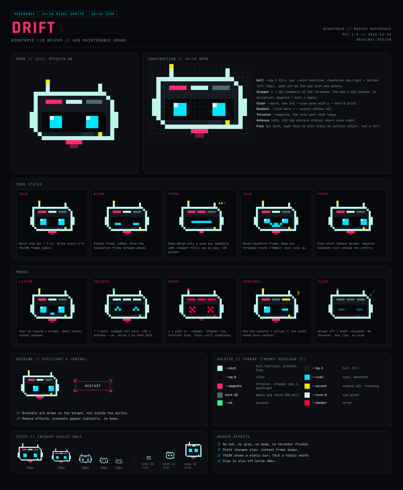

# DRIFT: the LLM helper mascot

DRIFT is a small HUD maintenance drone that floats beside the panel you're working in. It's the face of the opt-in LLM helper (see the backlog in `PROJECT_PROMPT.md`). It is an original design, so don't swap it for or blend it with characters from games or brands.

## Files

| File | What it is |
| --- | --- |
| `drift-reference.png` | Reference sheet: hero, construction grid, states, moods, spotlight, palette, sizes |
| `drift-sprites.json` | Every frame as pixel rows plus the colour key → CSS map. This is the source of truth for code |
| `sprites/drift-<state>.svg` | One SVG per frame (1 unit = 1 px, colours via CSS vars, no glow) |
| `sprites/drift-icon16-<state>.svg` | 16×16 status-bar icon (idle, think, error) |
| `tools/drift.py` | Generator for all of the above. Edit the sprite here, then re-run it |

To regenerate, run `python3 docs/mascot/tools/drift.py docs/mascot`. This writes the JSON, the SVGs and `drift-reference.html`. Screenshot that HTML at 1400 px wide and 2× scale to get the PNG. Don't commit the HTML.

## Construction

- **Grid**: 24×18 px for the panel sprite (row 17 is left empty for the hover bob) and 16×16 px for the icon.
- **Hull**: `--bg-2` fill with a 1 px `--mint` outline. The top-right and bottom-left corners have a 3 px chamfer, the same cut as the app icon and the UI panels (`--chamfer`).
- **Forehead stepper**: three 4 px segments that mirror the app's top stepper. Magenta means active, mint means done, and dim means empty. It doubles as a status readout (see States).
- **Visor**: `--bg-0`. Two 3×3 `--cyan` eyes, each with a `--text-0` glint pixel.
- **Readout**: three `--line` bars and an `--accent` status LED in the bottom-right of the hull.
- **Antenna**: on the left, with an LED tip that mirrors status. There's a short stub on the right.
- **Fins**: 1 px mint. Keep them thin so mint stays an outline colour and never becomes a fill.
- **Thruster**: `--magenta` with a darker tail. It's the only part that loops.

## Palette

Colours are referenced by token, never hard-coded, so DRIFT follows the active theme. The JSON's `palette.<key>.css` gives the exact CSS value.

| Key | CSS | Use |
| --- | --- | --- |
| `M` | `var(--mint)` | hull outline, antenna, fins, "done" stepper segment |
| `D` | `var(--bg-2)` | hull fill |
| `B` | `var(--bg-0)` | visor |
| `L` | `var(--line)` | readout bars |
| `C` | `var(--cyan)` | eyes, mouth waveform |
| `W` | `var(--text-0)` | eye glint |
| `K` | `var(--magenta)` | thruster, active stepper segment, spotlight brackets |
| `Y` | `var(--accent)` | status LED, thinking ticker |
| `G` | `var(--ok)` | success LED and antenna |
| `R` | `var(--danger)` | error eyes, stepper and LED |
| `m` | `color-mix(in srgb, var(--mint) 35%, var(--bg-2))` | empty stepper segment |
| `c` | `color-mix(in srgb, var(--cyan) 35%, var(--bg-0))` | sleeping eyes |
| `k` | `color-mix(in srgb, var(--magenta) 45%, var(--bg-0))` | thruster tail |

Glow (the `--glow*` drop shadow) applies only to keys `C K Y G R O`, and only at 48 px and above.

## States

| State | When | Look | Motion (effects on) |
| --- | --- | --- | --- |
| `idle` | helper open, nothing happening | eyes open, stepper magenta/mint/empty | 2 px bob over 2.4 s; `blink` every 4–7 s |
| `blink` | blink frame, and the 1-frame transition between moods | eyes closed to a line | 120 ms |
| `think` | waiting for the first token | eyes merge into a scan bar, stepper `KKm`, small thruster | bar sweeps left and right, stepper fills one segment at a time, LED pulses, yellow 3-dot ticker |
| `talk` | streaming a reply | eyes look up, mouth waveform | mouth frames swap per streamed chunk (~90 ms) |
| `point` | guiding the user to a control | eyes shift 2 px toward the target | dashed magenta beam from the drone to the target, brackets lock on |
| `listen` | user is typing in the helper input | small mouth | none |
| `success` | fix applied, file saved, task done | `^ ^` eyes, stepper all mint, LED and antenna `--ok` | holds 1.5 s, then `idle` |
| `error` | model failed, not loaded, no GPU | `x x` eyes in `--danger`, stepper red, thruster dim | none; stays until dismissed |
| `confused` | model needs more context from the user | one eye squints, yellow `?` beside it | none |
| `sleep` | helper off or model unloaded | dim eye lines, no thruster | none, no glow |

Only the shape changes between frames, so a frame swap is a step change with no tweening. Run animations on a 120 ms step clock so they feel like a terminal.

## Guiding (spotlight)

When the helper points the user at a control, the spotlight is drawn **on the target** and not inside the sprite:

- Four 2 px magenta corner brackets sit 5 px outside the control's box, and each arm is 9 px long.
- The target's border switches to `--magenta` with `--glow-active`.
- DRIFT switches to `point` and moves next to the target if it fits, otherwise it stays docked. A dashed beam joins the two.
- The spotlight clears on click, on Esc, or after 8 s.
- The spotlight is decoration, so it must never block clicks. Use an overlay with `pointer-events: none`. Give the target an `aria-describedby` that points at the helper's explanation text.

## Reduce effects

This applies whenever `:root[data-effects="off"]` is set, the plain theme is active, or the OS asks for reduced motion:

- No bob, glow, beam, thruster flicker, sweeping scan bar or ticker.
- States still change as instant frame swaps, so `think` shows a static bar and `talk` a static mouth.
- The spotlight brackets appear instantly with no beam, and the target border still turns magenta.
- Blinking stays, because it's a single frame swap every few seconds, not continuous motion.

## Sizes

- Draw at integer scales only (1×, 2×, 3×…) with `image-rendering: pixelated` / `shape-rendering: crispEdges`. Never use fractional scaling, because it blurs the pixel edges.
- The helper panel uses the 24×18 sprite at 3× (72×54) by default and 4× (96×72) when there's room.
- Inline in chat messages it's 2× (48×36).
- In the status bar, tabs and menus, use the 16×16 icon at 1× or 2×. Don't shrink the 24 px sprite below 2×, because the eyes merge.

## Name

The name is **DRIFT**, always written in caps in the UI, like other HUD labels. The helper speaks in plain sentences and never refers to itself in the third person.
